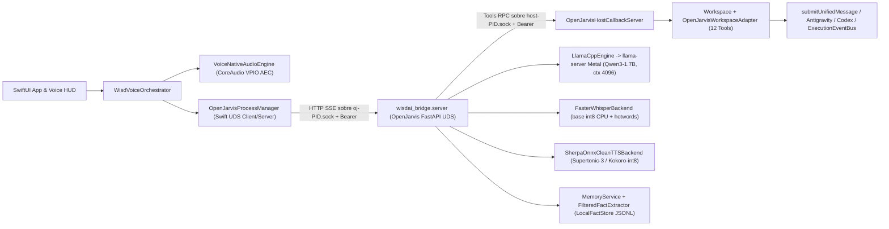

# Arquitetura Nativa OpenJarvis no WisdAI

## Visão Geral em Camadas

## Componentes Removidos vs. Adicionados

### Removidos (`5` ficheiros obsoletos eliminados)
- `VoiceStudioDSPProcessor.swift` — filtros de ressonância metálica e pitch-shifting WSOLA removidos por causarem distorção robótica.
- `VoiceBehaviorEngine.swift` — templates rígidos de backchannel e heurísticas artificiais substituídos pelo streaming conversacional do OpenJarvis.
- `VoiceVocalizationCache.swift` — pré-aquecimento e injeção sintética de vocalizações (`"uhum"`, `"aham"`) removidos.
- `LocalIntelligenceEngine.swift` — roteador heurístico por regex e cérebro paralelo substituídos pelo `OrchestratorAgent` com `function_calling` real.
- `VoiceLaboratoryView.swift` — calibrador legado DSP/metálico removido da UI de configurações.

### Adicionados e Adaptados
- [OpenJarvisBridge.swift](file:///Users/andregabry/Project/WisdAI/codex/desktop/macos/OpenJarvisBridge.swift): gerencia diretórios privados (`~/Library/Application Support/WisdAI/OpenJarvis/{bin,venv,run,logs,memory}`), provisionamento offline/online via `uv`, sockets `AF_UNIX` autenticados (`oj-<pid>.sock` e `host-<pid>.sock`), coalescência concorrente de boot (`bootTask`), streaming SSE com parser chunked seguro, cancelamento instantâneo de turno de áudio (`cancelActiveVoiceTurnAudioOnly`), recuperação automática em crash e `shutdown()`.
- [OpenJarvisWorkspaceAdapter.swift](file:///Users/andregabry/Project/WisdAI/codex/desktop/macos/OpenJarvisWorkspaceAdapter.swift): implementação `@MainActor extension Workspace` dos 12 contratos `OpenJarvisToolName` e geração do snapshot em tempo real (`buildOpenJarvisWorkspaceContextDictionary()`).
- [VoiceOrchestrator.swift](file:///Users/andregabry/Project/WisdAI/codex/desktop/macos/VoiceOrchestrator.swift): direciona turnos conversacionais para `/v1/wisdai/voice/stream` com acumulação ordenada via `TurnBox`, mantendo `VoiceNativeAudioEngine` (`VPIO` AEC e barge-in) e `workspaceSnapshotProvider`.
- [VoiceMemoryAndTelemetry.swift](file:///Users/andregabry/Project/WisdAI/codex/desktop/macos/VoiceMemoryAndTelemetry.swift): particionamento estrito de `sessionTurns` e `compactedSummary` por projeto (`scopedProjectHistories`) dentro de `VoiceMemoryStore.updateWorkspaceContext`, evitando vazamento de contexto ao trocar entre repositórios.
- [VoiceNeuralRuntime.swift](file:///Users/andregabry/Project/WisdAI/codex/desktop/macos/VoiceNeuralRuntime.swift): adiciona `--jinja` ao `llama-server`, amplia janela de contexto para `--ctx-size 4096` (8 GB) / `8192` (>=16 GB) e aplica `centerAudioDCOffset` nas saídas `KokoroNeuralTTSProvider`.
- [OpenJarvisRuntime/wisdai_bridge/](file:///Users/andregabry/Project/WisdAI/codex/desktop/macos/OpenJarvisRuntime/wisdai_bridge/server.py): pacote puente contendo `server.py`, `streaming_turn.py` (streaming incremental token/sentença + filtro `<think>` + resgate seguro `_extract_text_tool_calls`), `tools.py`, `persona.py`, `memory_guard.py`, `tts_sherpa.py` e `host_client.py`.

## Fluxo de Interrupção (Barge-In vs. Tarefa em Segundo Plano)

1. Quando o utilizador começa a falar durante a reprodução, `VoiceNativeAudioEngine` limpa o buffer de saída imediatamente (`outputJitterBuffer.flush`).
2. `WisdVoiceOrchestrator` chama `openJarvis.cancelActiveVoiceTurnAudioOnly()`, fechando o descritor POSIX do stream SSE e disparando `POST /v1/wisdai/voice/cancel`.
3. O evento de cancelamento no servidor (`TurnCancellationRegistry`) interrompe apenas a geração conversacional do turno vocal em curso — **nunca** invoca `cancel_task` no `Workspace`. Tarefas do `Codex` ou `Antigravity` em segundo plano seguem intactas até instrução explícita do utilizador.

## Transporte, Segurança e Isolamento

- Toda comunicação local Swift ↔ OpenJarvis utiliza **Unix Domain Sockets (`AF_UNIX`)** com permissão restritiva `0700`/`0600` em diretório privado de suporte do app e **Bearer Token aleatório de 48 hex chars gerado por sessão** nos dois sentidos (`apiToken` e `hostToken`).
- Nenhuma porta TCP externa ou pública é aberta pelo daemon OpenJarvis; o `llama-server` local vincula apenas `127.0.0.1`.
- Ao fechar a aplicação (`shutdownGracefully()` / `NSApplication.willTerminateNotification`), `OpenJarvisProcessManager.shutdown()` encerra o processo daemon e remove os ficheiros `.sock`.
